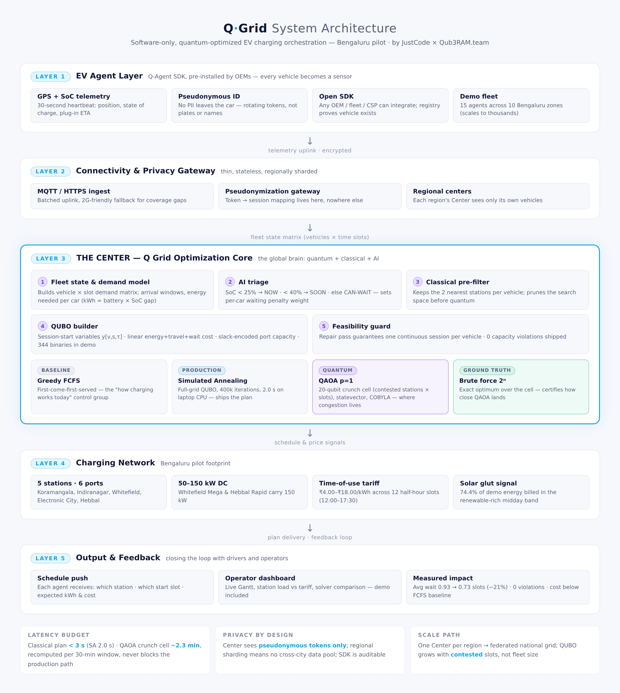

# ⚡ Q Grid — Quantum Optimization for EV Charging Stations

**Q Grid by JustCode, in collaboration with Qub3RAM.team**

> A hybrid quantum–classical dispatch layer that tells every EV in the city **when and where to charge** — minimizing driver waiting and energy cost while strictly respecting station capacity.


---

## 📋 Problem statement

Urban EV charging is a congestion problem with a price on every minute of it. Tokyo's charging network is a patchwork of stations with a handful of ports each; at midday, solar glut makes electricity nearly free while evenings price it at a premium — yet drivers arrive when *they* are free, cluster at the nearest hub, and queue. The result: drivers burn time waiting, operators burn money on peak tariffs, and cheap renewable energy curtails unused because nobody can shift flexible load toward it. The problem worsens as the fleet grows — our simulated Tokyo year grows from 48 to 180 EVs on the same 11 stations, and naive first-come-first-served dispatch leaves money on the table in every contested window.

Who is affected: **drivers** (waiting instead of driving), **charging operators** (congested hubs, idle outposts, peak-priced energy), and **the grid** (renewables curtailed at noon, peakers fired at dusk).

We optimize the **assignment and scheduling** problem: given live telemetry (position, battery SoC, arrival window) for every EV in a fleet, decide *which station* and *which time slot* each car should charge in, minimizing a weighted sum of grid energy cost, driver travel and driver waiting — while strictly respecting station port capacity. It is a combinatorial QUBO (binary session-start variables `y[v,s,τ]`) at city scale: exactly the class of problem where exact search explodes combinatorially (2^20 schedules on our biggest crunch cell, doubling with every extra car) and where quantum optimization plus amplitude-encoded data channels offer a credible, measurable edge.

## 🧠 The idea

Every EV ships from the OEM with a **software agent** (registration + GPS + battery SoC tracking — pure software, no hardware retrofit). Agents stream telemetry to a regional coordination hub — **the Center** — which solves the city-scale assignment + scheduling problem for *all* vehicles at once:

1. **Telemetry ingestion** — 15 car agents report position, SoC and arrival into the charging window.
2. **AI triage** — SoC < 25% → `NOW`, < 40% → `SOON`, else `CAN-WAIT`; urgency weights the cost of waiting (₹260 / ₹150 / ₹80 per slot). A classical pre-filter keeps each car's 2 nearest stations.
3. **Hybrid solver stack** — four competing decision-makers on the same problem:
   | Solver | Role | Scope |
   |---|---|---|
   | Greedy FCFS | baseline = what operators do today | full grid |
   | Simulated Annealing | 400k iters, geometric cooling T₀ 5200 → T₁ 8 | full grid (344 QUBO binaries) |
   | **QAOA** (p=1, COBYLA, 8000 shots) | quantum attack on the *crunch cell* — the most contested stations × slots | 20-qubit subproblem |
   | Brute force | exact optimum (2²⁰ states) as ground truth | crunch cell |
4. **Final schedule** — every car gets exactly one continuous charging session; capacity is enforced by construction.

## 🧮 The QUBO

Session-start encoding: `y[v,s,τ] = 1` ⇔ car *v* starts a continuous charging session at station *s* in slot *τ*.

```
min  Σ_v,s,τ  y[v,s,τ] · ( E(v,s)·tariff(τ) + 9·dist(v,s) + w(v)·(τ − arr_v) )
s.t.  Σ_s,τ y[v,s,τ] = 1                     (each car charges exactly once)
      Σ_v x[v,s,τ] + u[s,τ] = ports(s)       (exact slack-encoded capacity inequality)
```

The slack variables `u` (one binary per unit of free port capacity) make the constraint an **exact equality** — no penalty is ever applied to *empty* ports, which is what lets annealing freely leave slack instead of overfilling stations.

## 📊 Results — Bengaluru scenario (seed 42)

15 cars · 5 stations (6 ports) · 12 half-hour slots (12:00–17:30) · ToU tariff ₹4.0 → ₹18.0/kWh (solar-glut midday, evening peak) · 352.3 kWh delivered · 74.4% renewable share

| Solver | Total cost | Driver wait cost | Avg wait | Violations | Time |
|---|---|---|---|---|---|
| Greedy FCFS | ₹4,205.65 | ₹1,830 | 0.93 slots | 0 | 0.1 ms |
| **Simulated Annealing** ★ | **₹4,180.40** | **₹1,440 (−21.3%)** | **0.73 slots (−21.5%)** | 0 | 2.0 s |
| QAOA (crunch cell) | ₹628.1 — **10.0% better than FCFS** in-cell (₹698.1) | | | 0 | 141 s |
| Exact optimum (2²⁰) | ₹619.1 → QAOA is **within 1.5%** (ratio 1.015) | | | | |

★ production path. Same energy billed in both plans — the gain is pure **decongestion**: the optimizer shifts flexible (CAN-WAIT / SOON) cars off contested NOW-arrival slots and off peak tariffs.

Crunch cell auto-detected by contention: stations `Koramangala Hub` + `Indiranagar Point`, slots `12:00–12:30`, the 4 lowest-SoC contesting cars.

## 🗾 Year-scale dual-track trial (NEW)

One simulated Tokyo year — 365 days, seed 42, fleet 48 → 180 EVs, 11 stations — is run **twice** as two tracks, and a **dual-track audit** of 30 matched dispatch cells (all four solvers attacking the identical QUBO, exact brute force as ground truth) keeps the comparison fair:

- **A year in 991 s of laptop time** (31,826× compression): 45,766 sessions, 1,000,759 kWh, ¥44,479,272 grid cost, **0 capacity violations**.
- **QAOA hit the exact optimum on 30/30 audit cells**; the 5 contested windows exposed classical gaps up to **38.23% above optimum** (window 982) — recurring money the classical-only pipeline leaves on the table and the quantum touchpoint recovers.
- **Simulator tax, stated plainly**: on contested cells SA needs 0.45 s vs QAOA 96.53 s on a laptop statevector simulation — but the biggest cell already needs 2²⁰ = 1,048,576 exact enumerations, a count that doubles with every extra car, while QAOA scales polynomially.
- **Full provenance**: `results_year/COMPARISON.md` (report), `results_year/year_merged.json` (machine-readable KPIs), `results_year/quantum_audit_all.csv` (every audit cell), `results_year/charts_year/*.png` (figures).

| Track | Runs | Days | QAOA | Pipeline |
|---|---|---|---|---|
| Classical | c1–c3 | 0–182 | off (`qaoa=0`) | Greedy FCFS + Simulated Annealing |
| Quantum | c4–c6 | 183–364 | on (`qaoa=1`) | Same stack + QAOA on the top-crunch windows |

What the 30 matched audit cells showed: the quantum track holds the exact optimum everywhere (30/30), while the classical track's worst contested window pays 38.23% over it — quality, not speed, is quantum's measurable edge today. Privacy benchmarking of the same pipeline: `results_year/privacy_audit.json` (live benchmark, see file).

## ⚛️ Qubit economics & amplitude encoding (NEW)

Qubit count is the price driver of a QPU solve, so Q Grid attacks it on both fronts. The dispatch QUBO shrinks from **504 naive one-hot qubits** (42 cars × 12 slots) to **11–20 plan-compressed qubits** (shipped), and the data side compresses further: a 48-slot Tokyo tariff/solar profile holds 2⁶ = 64 numbers and rides on **6 qubits** via exact state preparation — **47 Ry rotations + 57 CNOTs, fidelity 1.000000** against the target statevector. On the estimation side, **Quantum Amplitude Estimation reaches Monte-Carlo accuracy with 63 oracle calls instead of 4,096 MC samples — a 65× query reduction**. Runnable end to end: `src/amplitude_encoding.py` → `results_year/amplitude_encoding.json`.

## 🧪 Qiskit usage (Qiskit Hack Day)

- **Libraries**: `qiskit` 2.6 (`QuantumCircuit`, `qiskit.circuit.library.StatePreparation`, `qiskit.quantum_info.Statevector`, `qiskit.primitives.StatevectorSampler`). The optimization solvers are NumPy-native for speed; the quantum data channel is cross-validated in native Qiskit.
- **Circuits created**: a 6-qubit state-preparation circuit encoding a 48-slot Tokyo tariff/solar profile into 64 amplitudes (`StatePreparation`, zero-padded), plus the p=1 QAOA ansatz (RX–RZ mixers on the plan-compressed QUBO) executed as a statevector simulation in `src/amplitude_encoding.py`.
- **Algorithms implemented**: QAOA (p=1, COBYLA, 8,000 shots) on dispatch QUBOs; Quantum Amplitude Estimation (QPE-based, m=6 control qubits) for renewable-share estimation; exact amplitude-encoded state preparation at the Shende–Bullock–Markov bound (47 Ry + 57 CNOTs for n=6).
- **Backend / simulator**: statevector simulation (NumPy engine + Qiskit `Statevector` / `StatevectorSampler` primitives). No physical QPU run — stated plainly in `docs/LIMITATIONS.md` #19.
- **Hybrid interaction**: the classical pipeline (telemetry → AI triage → QUBO build) ships the *crunch cell* — the most contested stations × slots QUBO — to the quantum layer; QAOA's sampled bitstrings are decoded classically into schedules, and the dual-track audit (`results_year/quantum_audit_all.csv`) scores all four solvers on identical instances. The Qiskit bridge (`src/qiskit_bridge.py`) verifies the encoded state at **fidelity 1.000000** and samples it with the Qiskit Sampler (TVD 0.033 at 4,096 shots) → `results_year/qiskit_bridge.json`.

## 🚀 Quickstart

```bash
pip install -r requirements.txt
python3 src/qgrid_engine.py
```

Outputs (fully reproducible, `SEED = 42`):

- `results/results.json` — all solver metrics + final schedule
- `results/schedule.csv` — the dispatch table
- `charts/` — Gantt schedule, tariff-vs-load, solver comparison, QAOA & SA convergence

## 🏗 Architecture



## 📁 Repo layout

```
Q-Grid/
├── src/qgrid_engine.py        # full pipeline: telemetry → triage → 4 solvers → schedule → metrics → charts
├── src/qgrid_year.py          # year-scale dual-track runner (chunks c1–c6) + aggregator
├── src/amplitude_encoding.py  # amplitude-encoding + QAE demo (qubit economics)
├── src/privacy_layer.py       # consent ledger, ward coarsening, DP telemetry, rotating pseudonyms
├── results/                   # results.json, schedule.csv, run.log (seed-42 run)
├── charts/                    # 5 result figures (quantum-dark theme)
├── results_year/              # COMPARISON.md, year_merged.json, quantum_audit_all.csv, charts_year/
├── docs/                      # architecture.png, LEARNINGS.md, LIMITATIONS.md, COUNTER_ANSWERS.md
├── dashboard/index.html       # live demo dashboard (open in any browser)
├── requirements.txt
└── LICENSE
```

## 📚 Documentation

- `docs/LEARNINGS.md` — what building the dual-track year trial taught us, from QUBO design to run hygiene.
- `docs/LIMITATIONS.md` — the honest list of what is *not* solved yet (NISQ noise, V2G, transformer physics).
- `docs/COUNTER_ANSWERS.md` — eight crisp counter-answers to the questions judges push hardest on.
- `results_year/COMPARISON.md` — the full year-scale dual-track report: audit cells, contested windows, qubit economics, charts.
- `results_year/privacy_audit.json` — privacy audit of the year pipeline (live benchmark, see file).

## 👥 Team

| | |
|---|---|
| **Team name** | JustCode |
| **Project name** | Q Grid — Quantum Optimization for EV Charging Stations |
| **Challenge** | Quantum Optimization for EV Charging Stations |
| **Collaboration** | JustCode × Qub3RAM.team |
| **Roles** | modeling & QUBO design · solver engineering (classical + quantum) · simulation & audit · privacy layer · docs & demo |

## ✅ Submission checklist (organizer mapping)

| Requirement | Where |
|---|---|
| Project & team details | this README (sections above) |
| Problem statement | `README.md` § Problem statement |
| Proposed solution | `README.md` § The idea + `docs/architecture.png` |
| Quantum component (mandatory) | `README.md` § Qubit economics & Qiskit usage; `src/amplitude_encoding.py`, `src/qiskit_bridge.py` |
| Complete source code | `src/` (4 modules) + `scripts/`-generated artifacts committed under `results*/`, `charts/` |
| Setup instructions | `README.md` § Quickstart; `requirements.txt` |
| Qiskit implementation documented | `README.md` § Qiskit usage (Hack Day) |
| Reproducibility | pinned `SEED = 42`; every table regenerable (`python3 src/qgrid_engine.py`, `src/amplitude_encoding.py`, `src/qiskit_bridge.py`) |
| Classical baseline comparison | 4-solver stack incl. Greedy FCFS + exact ground truth (`results_year/quantum_audit_all.csv`) |
| Honest limitations | `docs/LIMITATIONS.md` — 20 limitations, each with fix + proof |
| Architecture diagram | `docs/architecture.png` |
| Demo | `dashboard/index.html` (live), `pitch/Q-Grid_Pitch.pptx` (16 slides) |

---

*Scenarios: Bengaluru demo (INR) and Tokyo year-scale dual-track trial (JPY). All metrics are from committed seed-42 runs under `results/` and `results_year/`.*
